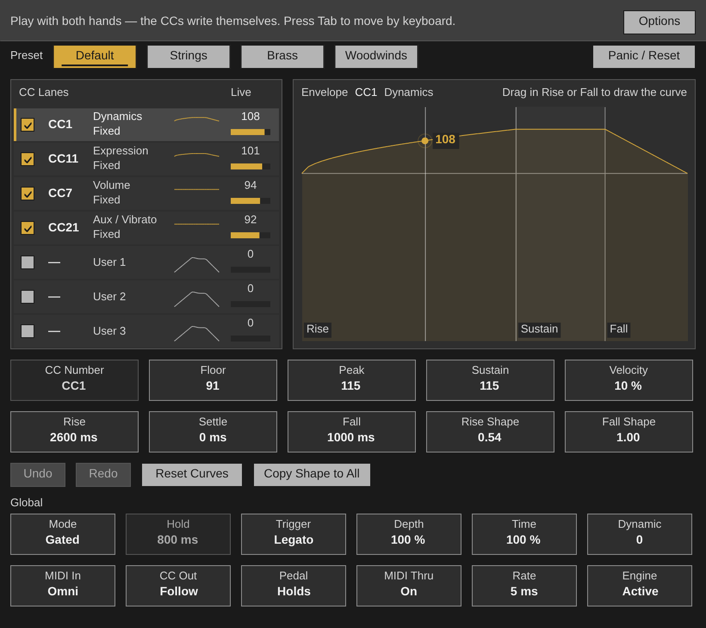

# AutoCC for Ableton Live

A Max for Live MIDI effect. It is `AutoCC.jsfx` itself, unchanged, running on Middaw's EEL2 runtime, with its own window: play a note and the CC arcs go to the instrument after it.

**Its colours are Live's**, after Ableton Live 8's default theme: neutral greys and one amber for what is on, so it sits beside Live's own devices. The REAPER version keeps the house scheme's yellow. The window is the script's own, drawn in those colours: its greys turn neutral at the same brightness, so every contrast it was checked for still holds, and its yellow becomes the amber.

## Installing

Needs **Live 12.1 or later with Max for Live** (Live Suite, or Standard with
the add-on): the device runs on Max 9's JavaScript engine (`[v8ui]`).

1. Copy `AutoCC.amxd`, `AutoCC.js` and `AutoCC.maxpat` into one folder, for
   example `Music/Ableton/User Library/Presets/MIDI Effects/Max MIDI Effect/`. The `.amxd` finds
   `AutoCC.js` beside it.
2. Drag `AutoCC.amxd` onto a MIDI track, in front of an instrument.
3. Optional: open it in the Max editor and click **Freeze Device**, then save.
   The device then carries the script inside it and can be moved on its own.

## Using it

| | |
| --- | --- |
| **Show Window** | Opens AutoCC's own window, the one REAPER shows: lanes, presets, the envelope, every control. Click, drag and Tab work as they do there. |
| The device | Put it on a MIDI track in front of an instrument that reads CC1, CC11 and the rest (most orchestral libraries). Notes pass through; the curves are added. |

Everything AutoCC saves in REAPER (its @serialize) is saved with the Live set.

## How it is built

`ableton/device.json` describes the device; `python3 ableton/kit/build.py
ableton/device.json` writes the `.amxd`, the `.maxpat` and the script bundle
`AutoCC.js`. The bundle is Middaw's EEL2 runtime, `AutoCC.jsfx` from the repository root, and the shared window (`ableton/kit/jsfx_device.js`, `gfx.js`). See `ableton/kit/VENDORED.md`.

`node --test ableton/tests/test_device.js` runs the device on a pretend Max and Live: the window draws and answers clicks all over it, notes go through and end, a held note plays a rising and falling arc, Tab moves the focus, and the state is saved only when it changes and comes back. `node ableton/kit/test/shot.js ableton/AutoCC.js 820 730 out.png` draws the window to a picture. `node ableton/window.js` redraws the picture above from the device's own drawing code (it needs Playwright's Chromium).

## Limits

- **It has not been opened in Live yet.** It is tested in Node against a stand-in for Max and the Live Object Model; nothing has run in Max. If the `.amxd` will not open, open `AutoCC.maxpat` in Max and save it as a device.
- MIDI goes in and out on Max's JavaScript clock, every 4 ms, not on the audio thread: up to a few milliseconds late, which an arc of CC or a held chord does not show but a tight rhythm may.
- Its controls are not Live parameters, so they cannot be automated or mapped; they are saved with the set.
- Clip envelopes for MIDI CC cannot be written from a device, so there is no Draw Into Clip: record the device's output on a second track instead.
